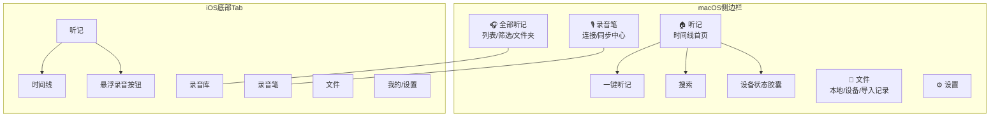
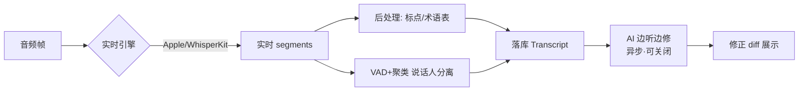
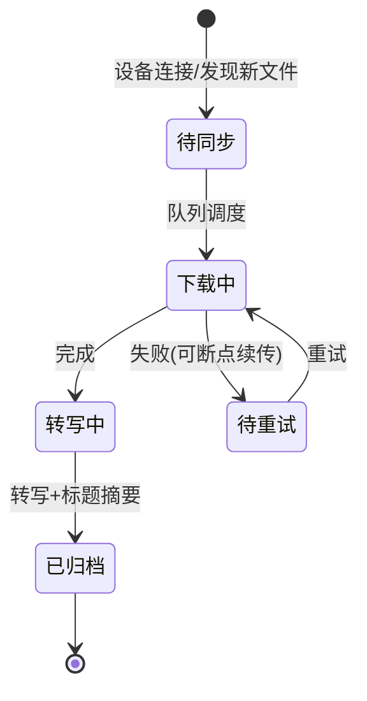
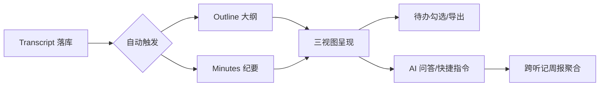
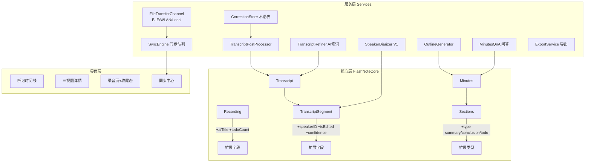

# FlashNote 重构设计：参考 QwenNote 界面逻辑 + 三大功能方案

**日期：** 2026-10-28
**状态：** 设计提案（待评审）
**范围：** UI 信息架构重构 + 语音转文字 / 传输 / AI 总结 功能方案
**适用：** macOS 14+ / iOS 17+ 双平台

---

## 0. 摘要

FlashNote 当前定位是「录音文件管理工具」：录音 → 存储 → 手动转写 → 手动生成纪要，界面以功能分区（工作台/录音库/文件/录音笔/设置）组织。

本次重构的核心判断：**把核心对象从「录音文件」迁移到「听记笔记」**，参考 QwenNote 的界面逻辑——以笔记时间线为首页、AI 提炼前置、原文/大纲/纪要三视图、转写即编辑、隐私可选项、每个内容都带 Action 出口。同时把 STT、传输、总结三条能力链从「手动编排」升级为「自动闭环」。

重构分三阶段：**P0（1–2 周）** 界面架构 + 录音/详情/首页改造 + 转写纠错与语种 + 自动纪要 + 导出；**P1（3–4 周）** 自动同步 + 大纲 + AI 问答 + 术语表 + 本地引擎 + 说话人分离 V1；**P2（5–8 周）** Wi-Fi 快传 + iCloud 同步 + 周报聚合 + 声纹。

---

## 1. QwenNote 界面逻辑解构（调研结论）

### 1.1 产品定位

QwenNote（通义笔记，钉钉科技有限公司，2026-09-22 云栖大会发布，配套名片大小 AI 硬件 A2）定位「AI 随身助理」，范式是**听记 → 转写 → AI 纪要 → Agent 执行**的自动化交付闭环。手机 App 是硬件内容的消费与加工中枢，一句话概括其界面哲学：**「以听记笔记为核心对象，把 AI 加工结果前置到列表，把下一步动作挂到每个内容上」**。

### 1.2 界面逻辑六原则（可迁移项）

| # | 原则 | QwenNote 表现 | 迁移到 FlashNote |
|---|---|---|---|
| 1 | **笔记对象化** | 首页是笔记时间线，不是功能宫格；每条听记是一个「事件」 | 首页从「功能工作台」改为「听记时间线」 |
| 2 | **AI 提炼前置** | 卡片直接显示 AI 提取的事件语义：「周末会议：新手们分享方案的细节评审 08:00-10:30」「语音生成待办自动归类」 | 列表行展示 AI 标题 + 纪要首段 + 待办数 |
| 3 | **一屏三视图** | 详情页「原文 / 大纲 / 纪要」多 tab，全文事实、结构脉络、AI 结论分离 | 详情页改为三 tab 结构 |
| 4 | **转写即编辑** | 转写过程支持 AI 边听边修（术语修正）+ 人工实时纠错 | 转写段落可点击就地编辑，术语表介入 |
| 5 | **隐私可选项** | 无痕模式：原始音频物理删除、仅留转写文本（「转后即焚」） | 录音页/设置提供无痕开关 |
| 6 | **Action 出口** | 一键提炼周报、整理待办、回顾进展；语音唤起 Agent 干活（发消息/建日程/建待办/生成表格） | 详情页底部动作条：复制/导出/生成待办/AI 问答 |

### 1.3 功能能力矩阵（调研证据）

| 能力 | QwenNote | 证据来源 |
|---|---|---|
| 实时转写 | 120 种语言、30 种方言；中英双语识别、语种切换 | 小米应用商店介绍 |
| 同传翻译 | 79 种语言同传、3 秒双向翻译 | 小米应用商店介绍 |
| 发言人 | 声纹识别角色、自动提炼重点 | 商店截图「AI纪要：声纹识别角色」 |
| AI 纪要 | 自动生成：大纲（时间轴分段）+ 纪要 + 待办，原文/大纲/纪要视图 | 商店截图「数字化创新与协同峰会」大纲 09:00-10:30 分段 |
| AI 问答 | 基于全部听记素材问答 + 快捷指令（本周关键结论/待办/进展与阻碍） | AI TNT 报道 |
| 传输 | 蓝牙 + 同局域网 Wi-Fi 快传，**仅在本地完成**、不上云 | QwenNote 隐私政策 |
| 隐私 | 无痕模式，转后即焚（转写完成后原始录音物理删除） | 商店截图 + 新浪财经报道 |
| Agent 协同 | 一键唤起千问办公执行后续任务 | 深圳晚报/华尔街见闻报道 |

### 1.4 竞品参考：WPS 笔记（36氪 2026-06）

- AI 多级自动标签体系取代文件夹归类，用户「只管丢进来」。
- 实时转写 + 发言人区分 + **「AI 边听边修」**（结合上下文修正专业名词、人名、项目名）+ **人工实时纠错**。
- 录音结束自动提炼重点、梳理待办。
- 全域多模态检索：图片、录音内容都能被口语化描述检索到。
- 笔记关联推送 + MCP 双向读写/CLI。

> 结论：行业共同方向是「存储 → 用起来」，AI 主动整理、自动归因、内容即输入。FlashNote 应吸收其中的**自动标签/事件化摘要、边听边修、结构化待办输出**。

---

## 2. FlashNote 现状盘点（代码级）

### 2.1 信息架构（`App/RootView.swift`）

```
macOS: NavigationSplitView 侧边栏 5 项          iOS: TabView 底部 5 Tab
├─ 工作台  WorkbenchView                        ├─ 工作台
├─ 所有录音 RecordingListView                    ├─ 录音库
├─ 文件    FileCenterView                       ├─ 文件
├─ 录音笔  DevicePanelView                      ├─ 录音笔
└─ 设置    SettingsView                         └─ 设置
```

### 2.2 页面与交互现状

| 页面 | 实现 | 关键交互 |
|---|---|---|
| 工作台 | 问候 + 「继续处理」首卡 + AI 纪要摘要条 + 最近 5 条列表 | 录音 = **Sheet 弹窗** `RecorderView`；导入 = Sheet |
| 录音页 | REC 指示 + 波形 + 大计时 + 实时转写 + 暂停/停止/完成 | 停止后立即 `dismiss()`，无收尾态 |
| 详情页 | 播放器 + 左「全文转写」右「AI 纪要」并排（窄窗口堆叠） | 纪要手动生成、风格 Picker、重新转写、删除 |
| 录音库 | 列表 + 工具栏（导入/新建） | 选择行进入详情 |
| 文件 | 本地文件 / 设备文件分段 | 无导出、无批量 |
| 录音笔 | BLE 独占会话：连接/扫描/电量/固件/录音控制/文件下载转写/实时推流 | 「下载并转写」为手动按钮 |
| 设置 | 外观、转写引擎、LLM 配置 | API Key 本地存储 |

### 2.3 服务与数据层

- **STT**：`SpeechEngine`（Apple Speech 实时，`LiveTranscriptionEngine` 协议）+ `CloudWhisperEngine`（导入，Whisper API）+ `WhisperKitEngine`（本地，未接入）。
- **传输**：`BLETransport` / `CB08Central`（CB08/QS668 协议）；文件导入 `.fileImporter`。
- **总结**：`MinutesGenerator`（OpenAI 兼容客户端）+ `MinutesTemplate.builtins` 模板。
- **存储**：本地 `Application Support`，`Recording` / `Transcript`（含 `TranscriptSegment`）/ `Minutes` 三模型。

---

## 3. 差距分析

| 维度 | FlashNote 现状 | QwenNote 做法 | 差距 | 优先级 |
|---|---|---|---|---|
| 核心对象 | 录音文件 | 听记笔记 | 高 | P0 |
| 首页 | 功能聚合工作台 | AI 笔记时间线 + 事件摘要 | 高 | P0 |
| 详情视图 | 转写+纪要并排 | 原文/大纲/纪要三视图 | 中 | P0 |
| 录音入口 | Sheet 弹窗 | 全屏听记页/一键听记 | 中 | P0 |
| 实时转写 | 单语种 Apple Speech | 多语种+切换+同传 | 高 | P0（切换）/P2（同传） |
| 发言人区分 | 无 | 声纹识别角色 | 高 | P1（分离）/P2（声纹） |
| 边听边修 | 无 | AI 术语修正 + 人工纠错 | 高 | P0（人工）/P1（AI） |
| 传输通道 | 仅 BLE 手动下载 | BLE + Wi-Fi 快传，本地完成 | 高 | P0（自动同步）/P1（Wi-Fi） |
| 自动归档 | 手动「下载并转写」 | 自动归档 + AI 标题/摘要 | 中 | P0 |
| 隐私模式 | 无 | 无痕模式/转后即焚 | 中 | P0 |
| AI 总结 | 手动 + 固定模板 | 自动 + 大纲 + 待办 + AI 问答 | 高 | P0（自动）/P1（问答） |
| 导出/分享 | 无 | 分享/协作 | 中 | P0 |
| 检索 | 无搜索 | 全局检索 + AI 问答 | 高 | P1 |
| 待办/行动闭环 | 无 | 结构化待办 + Agent 执行 | 中 | P1/P2 |

---

## 4. UI 重构方案

### 4.1 目标信息架构

**设计原则：** 一级对象 = 听记；设备与文件降为「来源」与「仓库」；首页只回答「我最近听到了什么、AI 帮我整理出了什么」。



**具体调整：**

1. **「工作台」→「听记」**（macOS 侧边栏首项 / iOS 首 Tab）：
   - 顶部一行：日期问候（精简）+ 全局搜索框 + 无痕模式开关 + 设备状态胶囊。
   - 常驻「一键听记」主操作（iOS 为悬浮录音按钮；macOS 为顶栏 prominent 按钮 + 键盘快捷键 ⌘R）。
   - 主体 = **按天分组的时间线**（今天/昨天/更早），每条是「听记卡片」而非文件行。
2. **「录音库」→「全部听记」**：保留列表 + 新增搜索/筛选（状态：转写中/已就绪/纪要就绪）+ 文件夹（M2 规划）。
3. **详情页 → 三视图**（见 4.3）。
4. **录音笔页 → 同步中心**（见 4.4 与 §5.2）。
5. **文件页**：分段改为「本地文件 / 设备文件 / 导入记录」，增加导出与批量。

### 4.2 听记卡片（列表单元，双端复用）

```
┌────────────────────────────────────────────┐
│ AI 标题：产品周会 Q3 路线图评审          [状态]│  ← 一级：AI 生成标题（无则「新笔记」）
│ 摘要：对齐了 3 季度优先级，待办 3 条…        │  ← 二级：纪要首段 / 转写首句
│ ⏱ 1:02:33 · 今天 14:20 · 5 个议题 · 3 待办  │  ← 三级：元信息 + AI 提炼计数
└────────────────────────────────────────────┘
```

- 新增 `Recording` 派生字段（不入核心模型，见 §6）：`aiTitle: String?`、`outlineCount`、`todoCount`、`speakerCount`。
- 状态三态：`transcribing`（实时进度条）/ `ready`（转写完成）/ `summarized`（纪要就绪，卡片加 sparkle 标记）。

### 4.3 详情页三视图（原文 / 大纲 / 纪要）

```mermaid
graph LR
    subgraph 详情页
        H[顶栏：标题/日期/时长/播放器/分享导出] --> TABS{分段控件}
        TABS --> T1[原文]
        TABS --> T2[大纲]
        TABS --> T3[纪要]
        T1 --> T1a[时间戳分段全文<br/>可编辑/可搜索/可复制<br/>发言人着色(未来)]
        T2 --> T2a[时间轴大纲<br/>议题+时间范围+要点<br/>点击跳转原文]
        T3 --> T3a[结构化纪要<br/>摘要/结论/待办清单<br/>风格选择+重新生成]
    end
    subgraph 底部动作条
        A1[复制全文] A2[导出] A3[生成待办] A4[AI 问答]
    end
```

- macOS 保留宽屏双栏（原文 + 纪要），但增加 tab 语义；窄屏/iOS 为三 tab 切换。
- 大纲段落携带 `startTime`，点击滚动定位原文对应段（`TranscriptSegment.startTime` 已有）。
- 待办清单为可勾选结构（`Minutes` sections 增加 `type: .todo`，见 §6）。

### 4.4 录音（听记）页改造

从 Sheet 弹窗升级为**全屏页面（iOS）/ 独立窗口（macOS）**，并在停止后进入「转写收尾」态，不再立即关闭：

```
┌──────────────────────────────────────┐
│ ● 正在录音  [无痕开关] [语种: 中/英/自动] │  ← 顶栏
│ ─────────── 波形 ──────────────────── │
│             01:02:33                 │
│ ┌──────────────────────────────────┐ │
│ │ 已定稿段落（可点击就地编辑）          │ │
│ │ 正在识别：当前句高亮…               │ │  ← 实时流
│ └──────────────────────────────────┘ │
│        [⏸暂停]   [■停止]            │
└──────────────────────────────────────┘
停止后 → 「转写收尾」态：
  定稿全文 + 保存/放弃 + 自动纪要进度 + 进入详情
```

关键交互：
- **语种切换**：中/英/自动（配合引擎 `locale` 参数）。
- **就地编辑**：点击已定稿 segment 文本 → 弹出编辑框 → 保存回 `TranscriptSegment`（`isEdited = true`）。
- **暂停标记**：暂停时插入 bookmark（后续大纲分段可参考）。
- **无痕模式**：开启后停止时删音频文件（`RecordingAssetService` 删除 caf），仅留转写文本；详情页播放器禁用并说明。

### 4.5 录音笔页 → 同步中心

保持设备会话独占，但改造内容分区：

1. **自动同步区**（新增）：连接后自动发现新文件 → 队列下载 → 自动转写归档；显示同步进度队列。
2. **传输通道指示**：BLE（小文件）/ Wi-Fi 快传（P1，大文件），显示当前通道与速度。
3. **文件行状态机**：`待同步 → 下载中(进度) → 转写中 → 已归档 / 失败(可重试)`。
4. 保留：电量/固件/录音状态/录音控制/实时推流/高级操作。

### 4.6 视觉与组件调整

- **保留**现有低饱和蓝紫主题、卡片圆角/细描边、等宽数字（已符合要求，不推倒重来）。
- **调整**：列表信息密度——AI 标题加粗 ≥ 摘要 ≥ 元信息；时间线分组标题（今天/昨天/更早）；状态双编码（颜色+文字徽标）。
- **新增组件**：`TintedSegmentedControl`（三视图）、`SyncStatusRow`（传输状态）、`CheckboxRow`（待办）、`FloatingRecordButton`（iOS）。

---

## 5. 功能方案

### 5.1 语音转文字（STT）

**现状**：实时 = Apple Speech 单语种（`LiveTranscriptionEngine`）；导入 = 云端 Whisper API；本地 WhisperKit 未接入。无语种切换、无纠错、无发言人、无术语优化。

**目标**：实时可切换语种、可随时人工纠错、可异步 AI 修词、逐步获得说话人分离。

#### P0（1–2 周）：可用性补全
| 项 | 方案 | 模块改动 |
|---|---|---|
| 语种切换 | `LiveTranscriptionEngine` 增加 `requestedLocale`，录音页顶栏选择 | `SpeechEngine` + `RecorderViewModel` |
| 人工纠错 | 点击已定稿 segment 就地编辑，保存 `isEdited` 标记 | `TranscriptSegment` + 详情/录音页 |
| 断句/标点后处理 | 本地管道：raw → 句末标点补全 → 术语表替换 → 落库 | 新增 `TranscriptPostProcessor` |
| 术语表 | 用户维护「专业名词 → 正确写法」表，后处理时替换；设置页管理 | 新增 `CorrectionStore`（本地文件） |
| 转写收尾态 | 停止后先出定稿全文，再决定保存 | `RecorderView` 状态扩展 |

#### P1（3–4 周）：准确率与离线
| 项 | 方案 | 模块改动 |
|---|---|---|
| 本地实时引擎 | 接入 `WhisperKitEngine` 流式（chunked）作为离线后备/默认（中文效果优于 Apple Speech） | `FileTranscriptionEngineFactory` 扩展 |
| AI 边听边修 | 转写完成后异步用 LLM 对全文做术语/错字修正（低优先级、可关闭），diff 显示 | 复用 `OpenAICompatibleClient`，新增 `TranscriptRefiner` |
| 说话人分离 V1 | VAD 分段 + 音频特征聚类 → 段落 `speakerID`，UI 着色/标记「发言者 A/B/C」；**受限于设备 16kHz 单声道 OPUS**，仅能做粗分离，无法做声纹人名识别 | 新增 `SpeakerDiarizer`（先接云端或 WhisperKit 能力） |

#### P2（5–8 周）：进阶
- 双语混合识别与同传字幕（依赖云端引擎/Whisper 大模型）。
- 声纹注册具体人名（需用户样本，涉及隐私说明）。

**STT 数据管道（目标态）**



### 5.2 传输

**现状**：BLE 手动「下载并转写」；导入 = 文件选择器；无自动同步、无导出。

**硬件核查（2026-10-28 实机验证，修正版）**：QS668/CB08 具备**双通道**——
1. **BLE 无线通道**：GATT Service 0xAE20（AE21 写 / AE22 主通知 / AE23 事件），用于实时推流、设备控制、无线下载；
2. **USB 大容量存储通道（新确认）**：设备支持 U 盘模式（FAT32，31.3 GB，卷名 NO NAME），录音文件位于 `record/noteYYYYMMDD-HHMMSS.wav` + 同名 `.opus`（成对存储），macOS 可直读挂载卷，USB 2.0 约 30 MB/s，**比 BLE 快约 1000 倍**；
3. 音频格式实机验证：WAV = 16 kHz / 16-bit / 单声道 PCM；OPUS = Raw Opus 16 kbps（40B/20ms 包，与现有 `OpusDecoder` 完全一致）；
4. **无 Wi-Fi 模块**——Wi-Fi 快传不成立，由 USB 直读替代其角色。

**平台约束（iOS 先行，关键）**：iOS 沙箱**无法直接挂载外部 U 盘**，因此：
- **macOS**：USB 直读 = 主通道，可实现全自动同步（卷挂载监听 → 扫描 `record/` → 增量导入 → 转写归档）；
- **iOS**：USB 直读需用户通过「文件」App / document picker 手动选择导入（设备出现于文件 App 侧边栏）；BLE 下载是 iOS 上可自动化的路径。

**目标**：双通道传输——macOS 以 USB 直读为主（秒级同步），BLE 为无线/实时通道并做吞吐优化（iOS 下载路径）；文件命名 `noteYYYYMMDD-HHMMSS` 直接提供录音时间，无需 BLE 时间戳。

#### P0（1–2 周）：USB 自动同步 + 导入 + 导出
| 项 | 方案 | 模块改动 |
|---|---|---|
| USB 卷自动同步（macOS） | 监听外部卷挂载（`NSWorkspace` didMount / FSEvents）→ 扫描 `record/` → 按文件名时间戳增量导入（跳过已导入 `note*`）→ 转写归档 | 新增 `USBVolumeSyncEngine` |
| 文件导入向导（iOS） | document picker 从「文件」App 选择设备录音（wav/opus）批量导入 → 转写归档 | `ImportAudioView` 重构 |
| 同步状态机 | `pending → copying(进度) → transcribing → done / failed` | `SyncEngine` + `DeviceFileRow` |
| 导出能力 | 分享音频（`ShareLink`/系统分享）、导出转写 txt/md、导出纪要 md | 新增 `ExportService` |
| 导入自动归档 | 导入文件自动转写，成功后进入听记时间线（标题先取文件名，P1 改 AI 标题） | `ImportTranscriptionViewModel` |

#### P1（3–4 周）：BLE 优化 + 云同步
| 项 | 方案 | 模块改动 |
|---|---|---|
| BLE 吞吐优化（iOS 无线路径） | 协商更大 ATT MTU（185–512B）；大文件走 2–12 分段并行下载 + 断点续传（协议已支持 offset） | `CB08Central` MTU 协商、`SyncEngine` 分段调度 |
| 传输协议抽象 | `protocol FileTransferChannel { func transfer(file, progress, completion) }`，实现：USBVolume / BLE / LocalFile | 新增协议层 |
| iCloud 同步 | 音频+转写+纪要结构化同步（M3 既有规划落地） | `RecordingStore` 云适配 |

#### P2（5–8 周）
- 多设备管理、WebDAV 等云盘导出；`record/` 目录变更监听（FSEvents 实时增量）。
- Wi-Fi 快传维持不成立（无 Wi-Fi 模块），不再列为实施项。

**传输同步状态机**



### 5.3 AI 总结

**现状**：手动点「生成」+ 固定内置模板 + OpenAI 兼容客户端。无大纲、无待办、无问答、无自动触发。

**目标**：转写完成自动生成、三视图展示、待办可勾选可导出、支持对全部素材提问。

#### P0（1–2 周）：自动 + 结构化
| 项 | 方案 | 模块改动 |
|---|---|---|
| 自动触发 | 转写完成后自动生成纪要（设置可关）；状态机 `transcribed → summarizing → summarized` | `MinutesGenerator` 触发点 + 列表状态 |
| 纪要结构升级 | sections 增加 `type`：`summary / conclusion / todo / detail`；待办段落为可勾选清单 | `Minutes` 模型扩展 |
| 大纲生成 | 新 `generateOutline(transcript)`：按时间轴分议题（标题+时间范围+要点），与原文时间戳关联、可点击跳转 | 新增 `OutlineGenerator` |
| 复制/导出纪要 | 一键复制 md、导出文件 | 复用 `ExportService` |

#### P1（3–4 周）：问答与提炼
| 项 | 方案 | 模块改动 |
|---|---|---|
| AI 问答 | 基于单条或全部听记的问答（检索 segments → 拼 prompt → LLM 回答）；详情页/全局入口 | 新增 `MinutesQnA`（RAG-lite） |
| 快捷指令 | 一键「本周要点 / 待办汇总 / 进展回顾」（跨多条听记） | `MinutesQnA` 预设指令 |
| 发言人级纪要 | 依赖 §5.1 说话人分离：按角色归纳观点 | `MinutesGenerator` 增强 |
| 模板扩展 | 会议/访谈/课堂/灵感 + 自定义模板 | `MinutesTemplate` 增加存储 |

#### P2（5–8 周）
- 周报/月报自动聚合；待办导出到系统提醒/日历（macOS/iOS 集成）。

**纪要生成闭环（目标态）**



---

## 6. 数据模型与服务层改动



### 6.1 模型扩展（向后兼容）

| 模型 | 新增字段 | 兼容性 |
|---|---|---|
| `Recording` | `aiTitle: String?`, `todoCount: Int`, `outlineCount: Int` | 可选字段，旧数据为 nil/0 |
| `TranscriptSegment` | `speakerID: String?`, `isEdited: Bool = false`, `confidence: Float?` | 可选，默认值 |
| `Minutes.Section` | `type: SectionType = .detail`（summary/conclusion/todo/detail）, `startTime: TimeInterval?` | 默认值兼容 |
| 新增 | `CorrectionEntry`（术语表）、`SyncTask`（同步队列持久化）、`OutlineSection` | 全新 |

### 6.2 服务层新增清单

| 服务 | 职责 | 依赖 |
|---|---|---|
| `SyncEngine` | 连接→发现→下载→转写→归档 队列调度，任务持久化，断点续传 | `FileTransferChannel`, `RecordingStore` |
| `TranscriptPostProcessor` | 标点补全、术语表替换、段落合并 | `CorrectionStore` |
| `TranscriptRefiner` | LLM 异步修正错字/术语，diff 展示 | `OpenAICompatibleClient` |
| `SpeakerDiarizer` | VAD + 聚类，输出 `speakerID` | 云端/WhisperKit |
| `OutlineGenerator` | 时间轴大纲（议题+时间范围+要点） | `OpenAICompatibleClient` |
| `MinutesQnA` | 单条/全局问答 + 快捷指令 | `OpenAICompatibleClient`, 检索 |
| `ExportService` | txt/md/音频导出 + 系统分享 | `RecordingAssetService` |

---

## 7. 实施路线（可量化验收）

| 阶段 | 周期 | 交付 | 验收标准 |
|---|---|---|---|
| **P0** | 1–2 周 | IA 调整（听记首页/三视图详情/录音全屏+收尾态）；**macOS USB 卷自动同步 + iOS 文件导入向导**；语种切换+人工纠错+术语表；自动纪要+待办结构化；导出 | ① 录音不再用 Sheet；② 停止后进入收尾态；③ 转写段落可就地编辑；④ 转写完成自动生成纪要；⑤ 音频/文本可导出；⑥ **macOS 插入设备自动导入新录音并归档** |
| **P1** | 3–4 周 | iOS BLE 吞吐优化（MTU + 分段并行）；大纲视图+点击跳转原文；AI 问答+快捷指令；本地 WhisperKit/SenseVoice 引擎；AI 边听边修；说话人粗分离（发言者 A/B/C） | ① iOS 无线下载 35min 录音（OPUS 4.2MB）≤ 90 秒；② 大纲可点击定位原文；③ 可对全部听记提问；④ 中文转写准确率提升（与 Apple Speech 对比测试） |
| **P2** | 5–8 周 | iCloud 同步；周报/月报聚合；说话人粗分离优化；`record/` 目录 FSEvents 实时增量；声纹人名识别挂起为硬件升级项 | ① 跨设备内容一致；② 周报一键生成；③ 插拔设备实时增量无需重扫 |

## 8. 风险与依赖

| 风险 | 影响 | 应对 |
|---|---|---|
| **已确认：设备无 Wi-Fi，但支持 USB 大容量存储（§10 实机验证）** | macOS 传输无忧；iOS 无法直挂 U 盘 | macOS 以 USB 卷自动同步为主通道；iOS 走 document picker 导入 + BLE 优化下载 |
| iOS 沙箱无法访问外部 U 盘文件系统 | iOS 端 USB 自动同步不可行 | 提供「文件 App 导入向导」；BLE 下载路径持续优化 |
| 设备 16kHz 单声道音频限制说话人识别 | 声纹人名识别不可行 | 只做 VAD+聚类粗分离（发言者 A/B/C），人名识别挂起 |
| WhisperKit 依赖网络/模型下载 | P1 本地引擎时间点 | 复用云端 Whisper 兜底；NextProto 已验证 SenseVoiceSmall 本地转写，可优先采用 |
| 自动纪要 + AI 修词 + 问答的 token 成本 | 使用成本上升 | 设置页提供「自动生成开关/频率」，修词仅对长录音开启 |
| 模型字段扩展 | 旧数据兼容 | 全部可选字段 + 默认值；`RecordingStore` 版本化迁移 |

## 9. 待确认问题（评审点）

1. **平台优先级**：已定 iOS 先行（用户确认），macOS 同步跟进。
2. **无痕模式默认值**：默认关闭（保留音频）还是默认开启？
3. **自动纪要**：默认开启还是需用户确认？（影响 token 成本）
4. **传输通道**：已实机核实（§10）——设备支持 **USB 大容量存储（macOS 直读主通道）+ BLE（无线/实时）** 双通道；无 Wi-Fi。
5. **P0 范围是否直接进入实现**，还是先出交互原型（HTML/Sketch）评审？

---

## 10. 硬件能力核查结论（2026-10-28，USB 实机 + NextProto 协议文档）

### 10.1 USB 连接核查（修正版）

首次检测（设备未插稳）时系统未枚举到设备，误判为「USB 仅充电」；用户重新插拔后实机验证：**QS668/CB08 支持 USB 大容量存储（U 盘模式）**——

- 挂载形态：外部物理磁盘 `/dev/disk4`，31.3 GB，FAT32，卷名 `NO NAME`；
- 文件结构：`record/noteYYYYMMDD-HHMMSS.wav` + 同名 `.opus`（成对存储，2 条实测录音）；
- 实测音频格式：WAV = 16 kHz / 16-bit / 单声道 PCM（RIFF fmt：rate 16000、byterate 32000、channels 1、bits 16）；OPUS = Raw Opus 16 kbps（40B/20ms 包，与 `OpusDecoder` 一致）；35.3 min 录音 = WAV 67.7 MB / OPUS 4.2 MB；
- 文件命名 `noteYYYYMMDD-HHMMSS` 直接编码录音时间，可作归档时间戳（无需 BLE 时间字段）。

**结论（修正）**：传输链路 = **USB 直读（macOS 主通道，约 30 MB/s）+ BLE（无线/实时/iOS 路径）** 双通道；iOS 因沙箱限制，USB 需经「文件」App / document picker 手动导入。

### 10.2 设备能力基线（对照架构要求）

| 架构要求 | 阶段 | 设备能力 | 结论 |
|---|---|---|---|
| **USB 直读同步（macOS）** | P0 | U 盘模式，`record/` 可读，文件名含时间戳 | ✅ 实机验证，主通道 |
| **文件导入向导（iOS）** | P0 | 经「文件」App / document picker 选择设备录音 | ✅ 可行（手动路径） |
| 实时转写（流式 ASR） | P0 | 实时 OPUS 推流（AE22，40B/20ms 包，16kHz） | ✅ 满足，可接流式 ASR |
| 远程录音控制 | P0 | 开始/保存/暂停/继续/状态/时长/文件名/增益 | ✅ 完全满足 |
| 语种切换/纠错/自动纪要 | P0 | 与硬件无关（App/引擎侧） | ✅ 满足 |
| 自动归档（AI 标题/摘要） | P0 | USB 文件名时间戳 / BLE 文件列表 | ✅ 满足 |
| BLE 断点续传（iOS 路径） | P1 | `offset` 续传、2–12 分段下载、MTU 协商 | ✅ 满足（需实现） |
| 说话人粗分离（A/B/C） | P1 | 16kHz 单声道：VAD+聚类可行 | ⚠️ 可做粗分离 |
| **Wi-Fi 快传** | 移除 | **无 Wi-Fi 模块**，由 USB 直读替代 | ❌ 不成立 |
| **声纹人名识别** | 挂起 | 16kHz 单声道不满足声纹精度 | ❌ 硬件升级项 |
| 无痕模式 | P0 | 与硬件无关（App 侧删除音频） | ✅ 满足 |

### 10.3 传输吞吐实测与估算（设计依据）

- 实机样本：35.3 min 录音 = WAV 67.7 MB / OPUS 4.2 MB（OPUS 16 kbps）。
- **USB 直读（macOS 主通道）**：USB 2.0 约 30 MB/s → 67.7 MB WAV ≈ **2–3 秒**；4.2 MB OPUS ≈ 亚秒级。
- **BLE（iOS 路径）**：默认 23B ATT MTU ≈ 2–8 KB/s → 4.2 MB OPUS ≈ 9–35 分钟；优化至 512B MTU + 2M PHY ≈ 50–200 KB/s → 4.2 MB ≈ **20–90 秒**。
- **结论**：macOS 传输瓶颈消除；iOS 需 BLE 吞吐优化或引导用户 USB 手动导入。

### 10.4 对架构的修订

1. §5.2 传输：新增 **USB 大容量存储通道**（macOS 主通道，卷挂载自动同步）；iOS 路径 = document picker 导入 + BLE 优化下载；Wi-Fi 快传移除（无硬件支持）。
2. §5.1 STT：说话人分离降级为「VAD+聚类粗分离（发言者 A/B/C）」，声纹人名识别挂起。
3. 本地引擎优先建议：NextProto 已在同款真机验证 **SenseVoiceSmall（FunASR）** 本地转写 16kHz 单声道音频，可优先于 WhisperKit 接入（模型约 900MB、离线可用）。
4. 实时推流链路：设备实时 OPUS 流 → `OpusDecoder`（已有）→ 流式 ASR，保持设计不变。
5. USB 同步实现要点：`NSWorkspace.didMountNotification` 监听卷挂载 → 过滤设备卷（FAT32 + 含 `record/`）→ 按 `note*` 文件名去重增量导入 → 复制到本地媒体库 → 转写归档 → 完成后提示可安全弹出。
